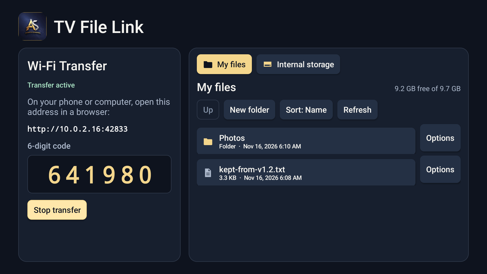
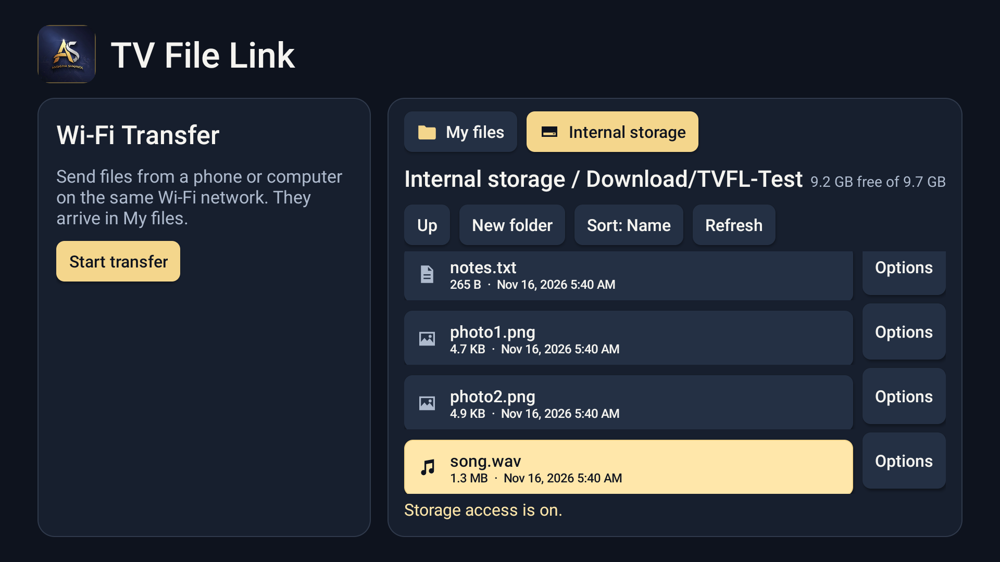
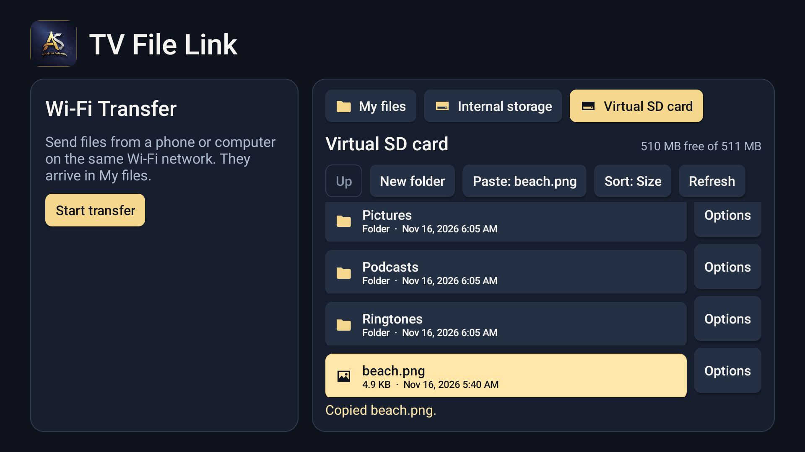
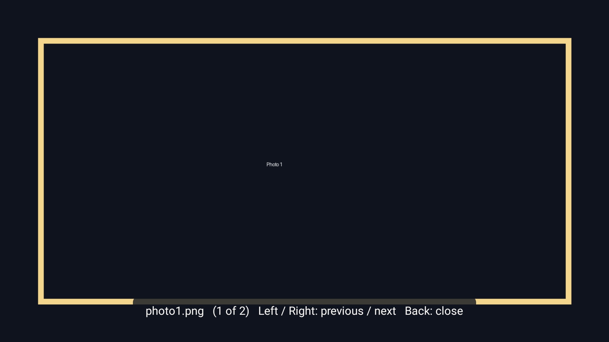
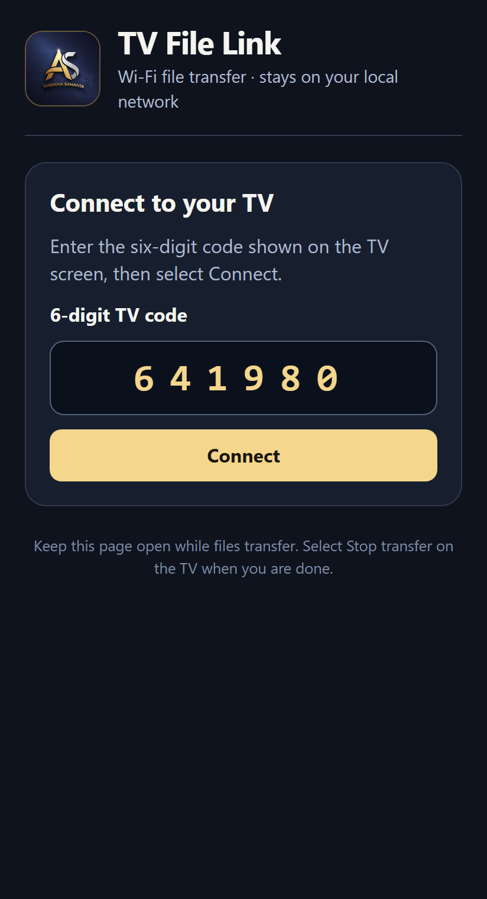
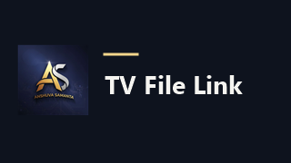

<p align="center">
  
</p>

<h1 align="center">TV File Link</h1>

<p align="center">
  <b>A file manager for Fire TV, with two-way Wi-Fi transfers from any web browser.</b><br>
  No cable, no cloud, no app on the phone: open the address shown on the TV and enter a six-digit code.
</p>

<p align="center">
  <a href="https://github.com/AnshuvaGitrepo/tv-file-link/releases/latest"></a>
  
  
  
  <a href="LICENSE"></a>
</p>

<p align="center">
  
</p>

---

## Download

| Edition | Package | Status |
| --- | --- | --- |
| **Fire OS 6 or newer** (Fire TV Stick, Cube, Fire TV smart TVs) | [`TV-File-Link-Fire-OS.apk`](https://github.com/AnshuvaGitrepo/tv-file-link/releases/latest) | Built and signed, v1.4. 129 of 129 automated checks passed on Android TV emulators. Not yet tested on a physical Fire TV. |
| **Vega OS** (newer Fire TV Sticks) | source in [`vega-os/`](vega-os) | Source only. The package (VPKG) must be built with the Vega SDK on Ubuntu or macOS: see [docs/VEGA-BUILD.md](docs/VEGA-BUILD.md). |

The release also carries two PDF guides: the **User Guide** and the **Installation and Testing Guide**.

## Features

**Wi-Fi transfer**
- Send files from a phone, tablet or computer to the TV, and download them back, using only a web browser.
- A fresh six-digit code for every session; each browser gets its own session key tied to its address.
- Wrong-code back-off (1, 2, 4 ... 60 s after three misses), rate limits, and a maximum of 8 devices per session.
- Numeric keypad for the code on phones, upload progress, Download buttons, clear error messages.
- Local network only: nothing goes through the internet.

**File manager (Fire OS)**
- Locations: **My files** (the app's library), **Internal storage** (Download, Movies, Pictures ...) and every **USB drive or SD card**. Drive tabs appear and disappear when drives are plugged in or removed.
- Copy, Move, Rename, New folder, Delete (folders after a warning that counts the items), Details, Sort by name, date or size.
- Built-in viewers: images (Left / Right for next and previous), video and audio player (Select = play / pause, Left / Right = -10 s / +10 s), text viewer.
- Open with another app for other file types.
- Made for the remote: D-pad everywhere, Back goes up a folder, the Menu key opens Options.

<table>
  <tr>
    <td align="center"><br><sub>Internal storage</sub></td>
    <td align="center"><br><sub>USB drive tab</sub></td>
  </tr>
  <tr>
    <td align="center"><br><sub>Image viewer</sub></td>
    <td align="center"><br><sub>Entering the code on a phone</sub></td>
  </tr>
</table>

<sub>Screenshots come from the Android TV emulator and Chrome. Addresses, codes and file names are sample values.</sub>

## How it works

1. Connect the Fire TV and the phone, tablet or computer to the same Wi-Fi.
2. Open **TV File Link** on the TV and choose **Start transfer**.
3. On the other device, open the `http://address:port` shown on the TV and enter the six-digit code.
4. Upload files with **Choose Files** and **Upload**, or select **Download** next to a file.
5. Select **Stop transfer**, or leave the app, to close the session.

Uploads go to **My files**. A connected browser can only see My files, never the rest of the TV's storage or USB drives. To move a file elsewhere, use the file manager on the TV.

## Install on a Fire TV

1. On the Fire TV: **Settings > My Fire TV > Developer options**, turn on **ADB debugging**. (If Developer options is missing, open **About** and select the device name seven times.)
2. Find the TV's address under **Settings > My Fire TV > About > Network**.
3. On a computer with the [Android platform tools](https://developer.android.com/tools/releases/platform-tools):

```bash
adb connect FIRE_TV_ADDRESS:5555
adb install -r TV-File-Link-Fire-OS.apk
```

Accept the debugging prompt on the TV the first time. The app appears under **Your Apps & Channels**. Version 1.4 installs over 1.2 and 1.3 and keeps My files.

More: [Amazon: connect to Fire TV through ADB](https://developer.amazon.com/docs/fire-tv/connecting-adb-to-device.html).

### Storage access

My files works without any permission. Internal storage and USB drives need one:

| Fire OS | Android | What to allow |
| --- | --- | --- |
| 6 and 7 | 7.1 / 9 | The Storage permission prompt. USB drives are **read-only** here (an Android 7-9 rule for apps): open files and copy them to My files or Internal storage. |
| 8 | 10 / 11 | **All files access**. USB drives are read and write. |

## Build from source

**Fire OS APK** (Windows; the script uses the Windows SDK and NDK tools): Python 3, Node.js, JDK 17+, Android SDK Platform 36, Build Tools 36.0.0, NDK 28.2.13676358, `ANDROID_HOME` set.

```bash
python fire-os/build-apk.py
```

The APK is written to `fire-os/TV-File-Link-Fire-OS.apk`. On the first build the script creates a local signing key. Keep it: Android only installs an update over an existing copy when both are signed with the same key. (Your own builds will therefore not update the official release, and the official release will not update your builds.)

**Vega OS** (Ubuntu 20.04+ or macOS, Vega SDK, Node.js 22.14+):

```bash
cd vega-os
npm ci
npm run build
```

Details, device checks and a fallback plan: [docs/VEGA-BUILD.md](docs/VEGA-BUILD.md).

## Project layout

| Path | Contents |
| --- | --- |
| `fire-os/` | Android app (Java UI, file manager, viewers) and the build script |
| `shared/` | C++ transfer server (cpp-httplib) and the browser page, used by both editions |
| `vega-os/` | React Native for Vega app and its native module |
| `docs/` | [File manager](docs/FILE-MANAGER.md), [testing](docs/TESTING.md), [Vega build](docs/VEGA-BUILD.md) |
| `work/tests/` | Emulator test suites (D-pad driven, SHA-256 checked) |
| `work/make_guides.py` | Builds the two PDF guides |

## Testing

All checks ran on Android TV emulators (x86, 1920x1080), driving the app only with remote key events:

| Suite | Android 9 (like Fire OS 7) | Android 11 (like Fire OS 8) |
| --- | --- | --- |
| File manager | 27 of 27 | 26 of 26 |
| Wi-Fi transfer | 38 of 38 | 38 of 38 |

Still to test on real hardware: a physical Fire TV Stick, a real USB drive on an OTG adapter, more video formats (MKV, HEVC, 4K), and the Vega edition. Full list and per-check results: [docs/TESTING.md](docs/TESTING.md).

## Security notes

- Transfers use plain HTTP on your local network, like most TV file-sharing apps. Use them on a trusted home network, not on public Wi-Fi.
- A transfer session only exists while it is shown on the TV; it ends with Stop transfer or when the app goes to the background.
- The browser can only reach My files. Files opened in other apps get a one-time, read-only grant.

## Changelog

See [CHANGELOG.md](CHANGELOG.md).

## License

[MIT](LICENSE) &copy; 2026 Anshuva Samanta. Includes [cpp-httplib](https://github.com/yhirose/cpp-httplib) (MIT).

<p align="center">
  <br>
  <sub>Prepared by Anshuva Samanta</sub>
</p>
